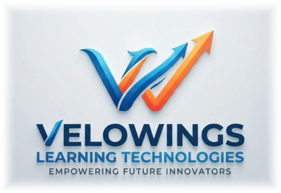

# VELOWINGS LEARNING TECHNOLOGIES

<p align="center">
  
</p>

<p align="center">
  <strong>Learn. Build. Grow. — Empowering Students for a Smarter Tomorrow</strong>
</p>

<p align="center">
  
  
  
  
</p>

---

## 🌟 Overview

**VELOWINGS LEARNING TECHNOLOGIES** is a cutting-edge educational platform and verifiable certificate issuance ecosystem. It empowers learners through interactive webinars, career roadmaps, and instantly verifiable digital credentials backed by client-side HD rendering and cryptographic verification hashes.

---

## 🚀 Key Features

- **🎓 Interactive Learning & Webinar Hub (`index.html`)**
  - Modern, responsive landing page showcasing tech domains, career pathways, speaker lineups, and curriculum.
  - Live Unstop participant sync and registration tracking.
  - Interactive certificate search & instant online verification.

- **📜 High-Precision Certificate Engine (`cert-engine.js`)**
  - Ultra-crisp HTML5 2D Canvas rendering engine with 300+ DPI print quality.
  - Custom embedded fonts: *Cinzel*, *Outfit*, and *Playfair Display*.
  - Dynamic QR verification generation linking directly to candidate credentials.
  - Export capabilities in both lossless PNG and high-resolution PDF format.

- **🎛️ Administrative Studio (`control.html`)**
  - Bulk certificate generation with instant CSV upload.
  - Real-time certificate visual editor & coordinate fine-tuning.
  - Firestore cloud synchronization with IndexedDB offline backup.
  - Automated ZIP packaging for bulk certificate downloads.

- **🏆 Specialized Portals**
  - **Winner / Distinction Portal (`winner.html`)**: Tailored certificates for hackathon and event winners.
  - **Jury & Evaluator Portal (`judges.html`)**: Official certificates of appreciation for event judges and mentors.

---

## 🛠️ Tech Stack

- **Frontend**: HTML5, Vanilla CSS3 (Custom Design System, Glassmorphism, Micro-animations), JavaScript (ES6+)
- **Rendering & PDF**: HTML5 Canvas, jsPDF, SweetAlert2
- **Database / Cloud**: Firebase Firestore & Cloudinary CDN
- **Deployment**: Vercel configuration (`vercel.json`)

---

## 💻 Local Development

To run the platform locally:

```bash
# Clone the repository
git clone https://github.com/aravinth081/velwoing-technologies.git
cd velwoing-technologies

# Start local server
npm run dev
# or
npx serve .
```

Visit `http://localhost:3000` in your browser.

---

## 📁 Project Structure

```text
├── index.html                 # Main website & certificate verification portal
├── control.html               # Admin control panel & bulk certificate generator
├── winner.html                # Winner & distinction certificate portal
├── judges.html                # Judges appreciation certificate portal
├── cert-engine.js             # Core certificate graphics & verification engine
├── unstop-sync.js             # Unstop registration sync utility
├── unstop-stats.json          # Cached registration metrics
├── vercel.json                # Vercel deployment configuration
├── package.json               # Project metadata & npm scripts
├── logo.png / logo-icon.svg   # Official brand identity assets
└── fonts / templates          # Custom typography & certificate templates
```

---

## 📜 License

This project is licensed under the **ISC License**. Developed with ❤️ by **VELOWINGS LEARNING TECHNOLOGIES**.
